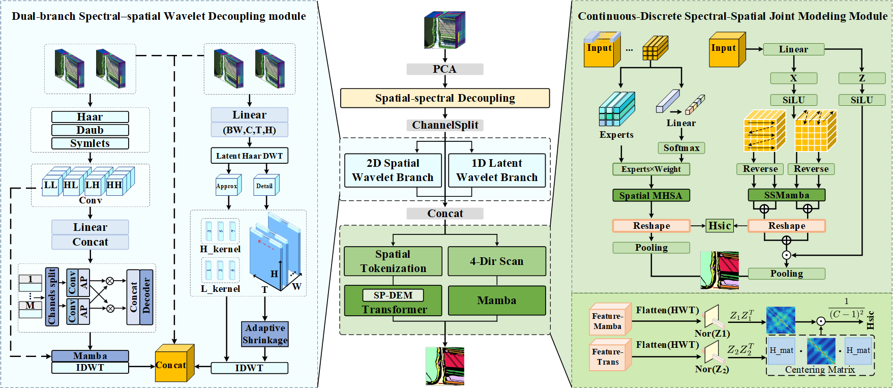

# WD-CMT

PyTorch implementation of **Wavelet Decoupling and Complementary Mamba–Transformer Modeling for Hyperspectral Image Classification**.

## Overview

WD-CMT combines wavelet feature refinement with complementary Mamba and Transformer modeling for hyperspectral image classification.

The framework consists of:

- **DSWD:** Dual-branch Spectral-Spatial Wavelet Decoupling for latent-feature and spatial-wavelet refinement.
- **CDS-SJM:** Continuous-Discrete Spectral-Spatial Joint Modeling, combining Mamba state propagation with Transformer interactions.
- **SP-DEM:** Spatial Pixel-wise Dense Expert Mixer for adaptive feature transformation.
- **HSIC regularization:** A training constraint for reducing redundant channel-response dependencies between the two modeling branches.

## Network Architecture



## Project Structure

```text
WD-CMT/
├── main.py                       # Training and evaluation
├── models/
│   ├── wd_cmt.py                 # Proposed WD-CMT network
│   ├── vssm.py                   # VSSM implementation
│   ├── csms6s.py                 # Selective-scan operators
│   ├── csm_triton.py             # Triton scan operators
│   ├── selective_scan_torch.py   # PyTorch selective-scan implementation
│   └── __init__.py
├── utils/
│   ├── utils.py                  # Logging and utility functions
│   └── __init__.py
├── assets/
│   └── architecture.png          # Network architecture figure
└── README.md
```

## Dependencies

The code uses the following Python packages:

- PyTorch
- torchvision
- timm
- numpy
- scipy
- scikit-learn
- pandas
- einops
- pytorch-wavelets

The default training configuration also requires a compatible `selective_scan_cuda` extension. The PyTorch scan backend must be explicitly selected when running without that extension.

## Dataset Preparation

Supported datasets:

- HanChuan
- LongKou
- Houston2013
- KSC

Datasets are not included in this repository. Download them separately and organize the files under the project root as follows:

```text
data/
├── hanchuan/
│   ├── WHU_Hi_HanChuan.mat
│   └── WHU_Hi_HanChuan_gt.mat
├── longkou/
│   ├── WHU_Hi_LongKou.mat
│   └── WHU_Hi_LongKou_gt.mat
├── Houston2013/
│   ├── Houston.mat
│   └── Houston_gt.mat
└── KSC/
    ├── KSC_corrected.mat
    └── KSC_gt.mat
```

## Training and Evaluation

Edit `DefaultConfigs` in `main.py` to select the dataset and configure the experiment.

For example:

```python
data = 'longkou'
train_epoch = 100
BATCH_SIZE_TRAIN = 64
init_lr = 0.001
patch_size = 11
pca_components = 30
seed = 345
```

Available dataset names are:

```python
'hanchuan'
'longkou'
'Houston2013'
'KSC'
```

Run the following command from the project root:

```bash
python main.py
```

Training selects model weights according to validation accuracy and then evaluates the selected model on the test set.

## Outputs

Model checkpoints and evaluation logs are saved under:

```text
checkpoint_merged/<dataset>/
```

The evaluation report includes:

- Overall Accuracy (OA)
- Average Accuracy (AA)
- Kappa coefficient
- Per-class accuracy
- Training and inference time
- Model parameters and FLOPs when profiling is available

FLOPs profiling requires the optional `thop` package.
